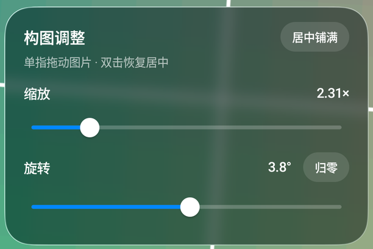
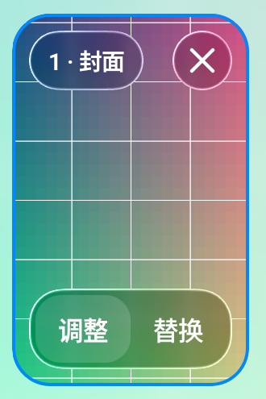

# 天音壁纸

基于开源项目改进的 Android 光栅壁纸应用，支持图片图集和视频壁纸。图片编辑时保持原始比例并始终铺满画布，可拖动构图、调节缩放与旋转；预览、保存和实际壁纸共用同一套变换规则。

> 当前版本：`4.0.1`（versionCode `48`）

## 功能

- **图片光栅壁纸**：添加多张图片，通过倾斜设备切换图片，并自定义切换过渡效果。
- **图片构图编辑**：单指拖动；缩放和旋转分别通过滑块调节；双击恢复居中铺满。图片按比例裁切填充，避免编辑后出现空白边缘。
- **图集管理**：预览图片、调整单张图片构图、替换或移除图片。
- **视频光栅壁纸**：通过倾斜设备控制视频播放进度。
- **液态玻璃界面**：图片卡片和构图控制面板使用半透明玻璃效果。

## 界面预览

| 图片构图编辑 | 图集图片卡片 |
| --- | --- |
|  |  |

## 构建

### 环境要求

- JDK 17 或更高版本
- Android SDK（建议通过 Android Studio 安装）
- 项目自带 Gradle Wrapper

### 命令行

```bash
./gradlew assembleDebug
./gradlew assembleRelease
```

APK 输出目录：`app/build/outputs/apk/`。

不设置签名环境变量时，`assembleRelease` 生成未签名 APK。需要本地签名时，通过 `KEYSTORE_PATH`、`KEYSTORE_PASSWORD`、`KEY_ALIAS` 和 `KEY_PASSWORD` 环境变量提供私有签名配置；不要把密钥或密码提交到仓库。GitHub Actions 发布需要在仓库的 **Settings → Secrets and variables → Actions** 添加 `KEYSTORE_BASE64`、`KEYSTORE_PASSWORD`、`KEY_ALIAS` 和 `KEY_PASSWORD`。更新地址会从 GitHub Actions 的仓库环境自动读取。

Windows 可使用 `gradlew.bat` 替代 `./gradlew`。

### Android Studio

使用 Android Studio 打开项目，等待 Gradle 同步完成后，从 Build 菜单构建 APK。

## 技术栈

- Kotlin、Jetpack Compose 和 Android Views
- OpenGL ES 2.0
- Android 传感器 API
- Gradle Version Catalog

## 上游来源与修改

本项目基于 [SUlTlUS/tianyinwallpaper](https://github.com/SUlTlUS/tianyinwallpaper)，该仓库承接自 [prpr12/tianyinwallpaper](https://github.com/prpr12/tianyinwallpaper)。本项目保留这两层上游来源与作者署名。

本仓库在上游项目基础上增加和调整了图片构图编辑、缩放与旋转控制、编辑器与壁纸渲染一致的图片变换、液态玻璃图片卡片，以及相关测试。主要代码文件顶部注明了修改内容；发布配置位于 `.github/workflows/build-apk.yml`、`app/build.gradle.kts` 和根目录 `.gitignore`。

## 许可证与第三方内容

本项目保留上游 Apache License 2.0 许可证文本，见 [`LICENSE`](LICENSE)。致谢上游作者与维护者：SUlTlUS（[GitHub](https://github.com/SUlTlUS)）以及原项目作者十二今天也很可爱（[@prpr12](https://github.com/prpr12)）。

应用依赖、图片、字体及其他第三方内容可能适用各自的许可证或使用条款；重新分发前请分别核对其来源和许可信息。项目包含的测试截图仅用于展示应用界面。
